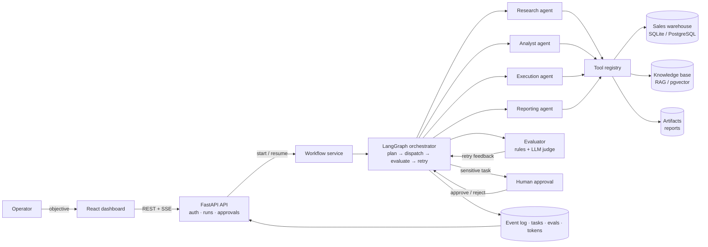

# AgentForge

**Autonomous multi-agent business automation — built like a product, not a demo.**

Describe a business task in plain English. AgentForge plans it, routes work to
specialist agents, executes real tools against real data, evaluates its own output,
retries failures with feedback, pauses for human approval before risky actions, and
returns an evidence-backed report — with every decision auditable in real time.

> Built with **Python 3.12 · FastAPI · LangGraph · SQLAlchemy · PostgreSQL/pgvector (or SQLite) · React + TypeScript · Groq / OpenAI / Ollama**

[Architecture](docs/ARCHITECTURE.md) · [API contract](docs/API_CONTRACT.md) · [Demo guide](docs/DEMO.md) · [Design decisions](docs/DECISIONS.md) · [Deployment](docs/deployment.md) · [Testing](docs/testing.md)

---

## Why this exists

Business teams don't need another chatbot. They need work executed reliably:
numbers retrieved from the warehouse, causes traced to evidence, risky actions
blocked until a human signs off, and a report they can defend.

Most "multi-agent" demos fail that bar: agents chat in a loop, tools are mocked,
there is no evaluation, and nothing is auditable. AgentForge demonstrates the full
production loop:

- **LangGraph controls the workflow** — agents never free-chat. They receive a
  defined task, allowed tools, prior results and an output schema.
- **Tools are real** — read-only SQL over a 15k-row sales warehouse, internal
  knowledge retrieval (RAG), report artifacts.
- **The system evaluates itself** — rules + an LLM judge score every task; failed
  tasks retry with targeted feedback.
- **Humans stay in control** — action-oriented tasks pause for approval; analysis
  runs end-to-end.
- **Everything is observable** — a sequenced event log, per-agent traces, tool calls,
  evaluation scores, token usage and artifacts.
- **The model layer is swappable** — Groq, OpenAI, Ollama or a deterministic mock via
  configuration, with no agent changes.

## The demo

Request:

> Analyze our sales performance, identify the three worst-performing products,
> investigate why they're underperforming, and generate a report with recommendations.

**Verified workflow baseline:** the offline scripted-LLM benchmark completed all 4
scenarios with all planned tasks completed, including approval pause/resume paths.
The measured p50 orchestration latency was 0.34 s; this excludes hosted-model latency
and does **not** measure answer quality. See [docs/BENCHMARK.md](docs/BENCHMARK.md)
for the reproducible run and limitations. The real-provider demo is available via
`scripts/demo_run.py`; live model results are intentionally not presented as verified
until the run completes with all tasks passing and evidence-grounded output.

## Architecture



| Layer | Responsibility |
|---|---|
| **Dashboard** | Submit objectives, watch agents work live, inspect plans/evals/tool calls, approve actions, read reports |
| **FastAPI** | JWT auth, run lifecycle, SSE event stream, approvals, metrics, artifacts |
| **LangGraph** | Typed shared state, planning, routing, task loop, conditional retry/approval edges |
| **Agents** | Research, Analyst, Execution, Reporting — bounded ReAct tool loops with JSON contracts |
| **Tools** | Typed registry: `sales_sql`, `csv_query`, `knowledge_search`, `web_search`, `report_writer` with scopes + sensitivity |
| **RAG** | Markdown-aware chunking, deterministic local embeddings, persisted vector store; pgvector-ready |
| **Evaluation** | Deterministic acceptance rules + LLM judge; scored retries |
| **Persistence** | Users, runs, task records, evaluations, approvals, artifacts, knowledge chunks, event log |
| **Ops** | Docker/Compose (Postgres+pgvector), GitHub Actions CI, structured logs, optional OTel/LangSmith |

## How a run executes

1. **Intake** — objective validated and stored against the user.
2. **Plan** — the planner returns a typed `Plan`: 3–6 tasks with agent assignments,
   dependencies, tool hints, expected outputs and success criteria. Action-taking
   tasks are marked `sensitive`.
3. **Route** — each task is validated against the capability registry and repaired if
   the planner hallucinated a role.
4. **Execute** — the assigned agent runs a bounded tool loop, logs each tool call,
   and returns a structured `AgentResult` (summary, findings with evidence, artifacts,
   confidence).
5. **Evaluate** — rules + an LLM judge score 0–1; below-threshold tasks retry (max 2)
   with concrete feedback.
6. **Approve** — sensitive execution tasks pause the run; the operator approves or
   rejects with a note.
7. **Synthesize** — a final Markdown business report is assembled from evidence,
   evaluations and artifacts, persisted and streamed to the dashboard.

## Agents

| Agent | Job | Tools | Example output |
|---|---|---|---|
| **Research** | Gather internal and market context for the objective | `knowledge_search`, `web_search` | Evidence-linked findings (pricing policy, quality escalation, marketing floor) |
| **Analyst** | Quantify performance and isolate drivers | `sales_sql`, `csv_query`, `knowledge_search` | Bottom-three products, YoY deltas, return/margin/ticket analysis |
| **Execution** | Turn findings into a concrete action plan (gated) | `report_writer` | Prioritized remediation plan with owners and expected impact |
| **Reporting** | Produce the executive deliverable | `report_writer`, `knowledge_search` | Structured Markdown report with recommendations and sources |

## Feature status

| Capability | Status |
|---|---|
| Dynamic planning | ✅ Typed planner with heuristic fallback |
| Agent routing | ✅ Capability registry + repair |
| Tool calling | ✅ Typed registry, scopes, validation, sensitivity |
| Shared state | ✅ LangGraph state + DB snapshot per node |
| RAG | ✅ Ingest, chunk, embed, retrieve (pgvector-ready) |
| Self-evaluation | ✅ Rules + LLM judge, persisted scores |
| Retry mechanism | ✅ Feedback-driven, bounded |
| Human-in-the-loop | ✅ Approval gate + API/UI actions |
| Observability | ✅ Sequenced event log, tool traces, token accounting, SSE |
| Benchmarking | ✅ Scenario harness (`scripts/benchmark.py`) |
| Auth & permissions | ✅ JWT, per-user run ownership |
| Production packaging | ✅ Docker, Compose, CI, health checks |
| Dynamic agent creation/publishing | ⏭️ Designed as the next advanced phase |

## Quickstart (Windows / PowerShell)

```powershell
# 1. Python environment
python -m venv venv
.\venv\Scripts\Activate.ps1
pip install -r requirements.txt

# 2. Configure
Copy-Item .env.example .env
# Edit .env: set GROQ_API_KEY (or LLM_PROVIDER=mock for a fully offline run)

# 3. Generate the demo warehouse + knowledge corpus (deterministic)
.\venv\Scripts\python.exe scripts\generate_demo_data.py

# 4. Run the headline workflow end-to-end (real LLM)
.\venv\Scripts\python.exe scripts\demo_run.py

# 5. Start the API
.\venv\Scripts\python.exe -m uvicorn app.main:app --host 127.0.0.1 --port 8000

# 6. Dashboard (new terminal)
cd frontend
$env:npm_config_cache="C:\Users\Mustafa\AgentForge\.npm-cache"
npm install
npm run build
# refresh http://127.0.0.1:8000 — FastAPI serves the built SPA
```

Open <http://127.0.0.1:8000>, sign in with `demo@agentforge.io` / `demo1234`, and submit
the sales-analysis objective (prefilled as a scenario).

**No PostgreSQL or Docker required for local dev.** SQLite is the default; PostgreSQL +
pgvector is the production path (`docker compose up --build`).

## Configuration

Key variables (full list with defaults in [.env.example](.env.example)):

| Variable | Default | Purpose |
|---|---|---|
| `SECRET_KEY` | dev placeholder | JWT signing key — **set a strong value** |
| `DATABASE_URL` | SQLite `data/agentforge.db` | PostgreSQL URL switches production storage |
| `LLM_PROVIDER` | `groq` if key present | `groq`, `openai`, `ollama`, `mock` |
| `LLM_MODEL` | `openai/gpt-oss-120b` | Model id for the selected provider |
| `GROQ_API_KEY` / `OPENAI_API_KEY` | — | Provider credentials |
| `MAX_AGENT_RETRIES` | `2` | Retry budget per task |
| `EVAL_PASS_SCORE` | `0.72` | Evaluation pass threshold |
| `HITL_ENABLED` | `true` | Enable human approval gates |
| `AUTO_APPROVE_DEFAULT` | `false` | Auto-approve sensitive tasks (use carefully) |
| `RAG_TOP_K` / `RAG_MIN_SCORE` | `5` / `0.08` | Retrieval breadth/threshold |

## API

Full contract: [docs/API_CONTRACT.md](docs/API_CONTRACT.md). Highlights:

```text
POST /api/auth/login                    → JWT
POST /api/runs                          → create + start a run (async)
GET  /api/runs/{id}                     → status, plan, token usage, pending approval
GET  /api/runs/{id}/events/stream       → live SSE event stream
GET  /api/runs/{id}/report              → final Markdown + artifacts
POST /api/runs/{id}/approvals/{aid}     → approve/reject a sensitive action
GET  /api/metrics/runs                  → success rate, latency, tokens, retries
GET  /api/tools · /api/agents           → capability catalog
POST /api/knowledge/ingest              → add a document to RAG
```

## Evaluation & benchmarks

AgentForge scores itself on two levels:

1. **Per-task** — deterministic acceptance rules plus an LLM judge, persisted in
   `evaluation_metrics`.
2. **System-level** — `scripts/benchmark.py` runs a scenario suite and reports
   completion rate, latency, evaluation scores, retries and token usage.

<!-- BENCHMARK-START -->
See [docs/BENCHMARK.md](docs/BENCHMARK.md) for the current measured results and the
exact command used to reproduce them.
<!-- BENCHMARK-END -->

## Testing

```powershell
.\venv\Scripts\python.exe -m pytest -q
```

Coverage includes security primitives, JSON extraction/repair, schema normalization,
tool-registry safety, RAG retrieval, API integration with a stubbed workflow, the full
LangGraph workflow with a scripted LLM (including retry and approval paths), and a
real-LLM smoke script. Details: [docs/testing.md](docs/testing.md).

## Deployment

```powershell
# Production-shaped stack: PostgreSQL 16 + pgvector, backend serving the built SPA
docker compose up -d --build
Invoke-RestMethod http://127.0.0.1:8000/api/health

# Optional profiles
docker compose --profile observability up -d   # OTel collector
docker compose --profile jobs up -d            # Redis (future background jobs)
```

See [docs/deployment.md](docs/deployment.md) for environment matrix, health checks,
migrations, security checklist and rollback, and
[docs/observability.md](docs/observability.md) for logs, traces and audit data.

## Project structure

```text
app/
  api/            FastAPI routers: auth, runs, SSE, approvals, artifacts, knowledge, meta
  orchestrator/   LangGraph graph, planner, router, executor, evaluator, synthesizer, service
  agents/         Research, Analyst, Execution, Reporting + bounded ReAct base agent
  tools/          Typed tool contract, registry, concrete tools
  rag/            Chunking, embeddings, persistent vector store, ingestion
  llm/            Provider abstraction: Groq/OpenAI/Ollama/mock
  core/           Config, security, logging, event broker, errors
  db/             SQLAlchemy models, engine/session, seeding
  schemas/        Pydantic API + workflow contracts
frontend/         React + TypeScript mission-control dashboard
tests/            Unit, integration, e2e workflow, benchmark
scripts/          Demo data generator, demo run, benchmark
docs/             Architecture, API, decisions, deployment, observability, testing
```

## Roadmap

- **Phase 1 — Foundation** ✅ FastAPI, SQLAlchemy (SQLite/Postgres), LLM provider,
  first LangGraph workflow.
- **Phase 2 — Multi-agent system** ✅ Four specialist agents, delegation, shared state,
  failure handling.
- **Phase 3 — Tools & RAG** ✅ Tool registry, read-only SQL, knowledge ingestion and
  semantic retrieval.
- **Phase 4 — Evaluation** ✅ Rule + LLM judge, feedback retries, scenario benchmarks.
- **Phase 5 — Frontend** ✅ Live mission-control dashboard with SSE, workflow graph,
  approvals, reports, metrics.
- **Phase 6 — Production** ✅ Docker/Compose, CI, JWT auth, observability, docs.
- **Next** — dynamic agent creation/testing/publishing, Redis-backed durable job queue,
  live web search, pgvector embeddings, refresh tokens/RBAC, cost budgets per tenant.

## Design decisions & limitations

The interesting engineering is documented honestly in
[docs/DECISIONS.md](docs/DECISIONS.md) and [docs/DEMO.md](docs/DEMO.md#demo-limitations-say-these-out-loud),
including: why LangGraph controls the flow, why tools are scoped capabilities, how
evaluation and retries work, the SQLite→Postgres path, and what is deliberately not
production-grade yet (in-process checkpointer for resume, LLM-as-judge variance,
offline-safe search tool, single-tenant permissions).

## License

MIT — see [LICENSE](LICENSE).
